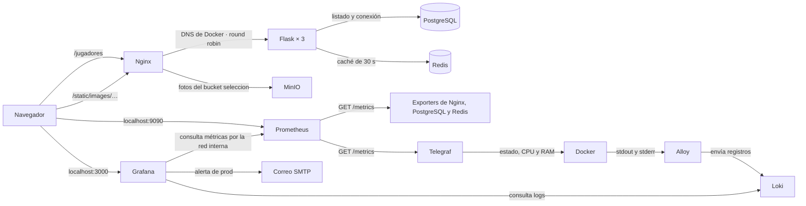
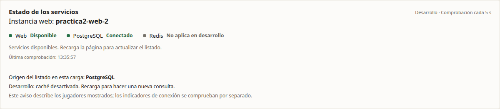
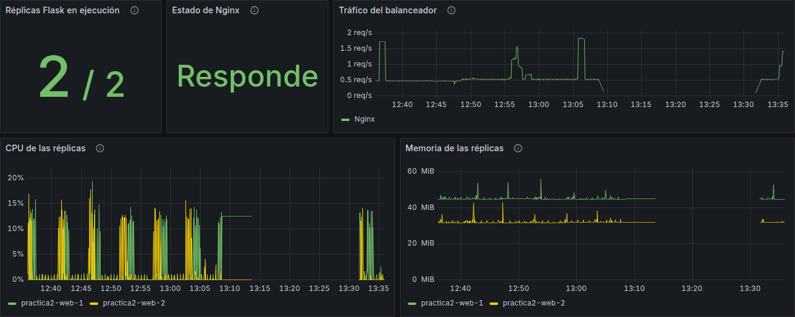
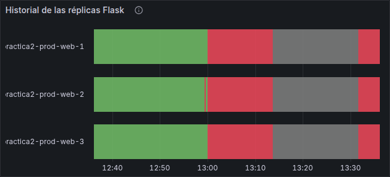
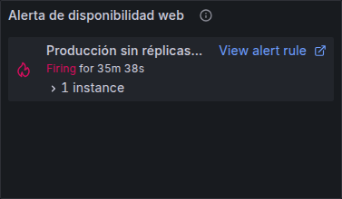
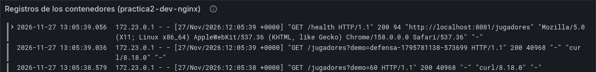

# Selección española · Terraform sobre Docker


La segunda práctica migra la aplicación de la selección española de Docker a Terraform. Un mismo equipo ejecuta dos entornos independientes y cada uno tiene su propio dashboard.

**Una visita a `/jugadores` permite seguir la infraestructura completa.** Nginx elige una réplica Flask, la página identifica quién ha respondido y las fotos llegan desde MinIO. En Grafana se puede seguir esa misma visita hasta el registro de acceso del balanceador.


**Guía de lectura** · [Arquitectura](#1-arquitectura) · [Dev y prod](#2-dev-y-prod) · [Despliegue](#3-despliegue) · [Módulos](#4-estructura-y-módulos) · [Grafana](#6-métricas-logs-y-alertas) · [Pruebas](#9-pruebas-y-resultados) · [Makefile](#10-comandos-del-makefile) · [Defensa](#11-defensa-en-directo)

## 1. Arquitectura

El diagrama representa producción. Desarrollo reutiliza los mismos módulos con dos réplicas web y prescinde de Redis, su exporter y la regla de alerta.



**Una visita a la web.** Docker lleva la petición del puerto publicado hasta Nginx. Para `/jugadores`, Nginx resuelve el alias compartido `web` en su red interna y dirige la petición a una réplica en el puerto 5000. Las réplicas ejecutan la misma aplicación y tienen el mismo peso, por lo que round robin reparte los turnos entre ellas. Nginx considera válida la respuesta DNS durante 5 s y vuelve a resolver el alias para recoger cambios de IP. El nombre que aparece en «Instancia web» lo genera la réplica que respondió. [Configuración de Nginx](modules/load_balancer/nginx-lb.conf.tftpl)

**Una foto del listado.** Flask entrega HTML con una ruta como `/static/images/jugadores/david-raya.avif`. El navegador hace una segunda petición. Nginx la dirige a `minio:9000/seleccion/jugadores/david-raya.avif`. Así todas las réplicas utilizan el mismo objeto. Terraform repite la carga cuando cambia el contenedor de MinIO, el script, el bucket o el contenido de las imágenes. [Carga inicial de MinIO](minio-seed.sh)



En la web, **Instancia web** identifica el contenedor que generó el HTML. **Origen del listado en esta carga** indica de dónde salieron los jugadores al cargar la página. Los indicadores de conexión se actualizan cada 5 s, incluso si mantienes esa página abierta.

## 2. Dev y prod

Los dos despliegues comparten el motor Docker. Cada uno tiene su estado de Terraform, redes, volúmenes y puertos propios.

| Componente | Desarrollo · `dev` | Producción · `prod` |
|---|---|---|
| Aplicación | [Plantilla en dev](http://127.0.0.1:8081/jugadores) | [Plantilla en prod](http://127.0.0.1:8080/jugadores) |
| Servidores web | 2 réplicas Flask | 3 réplicas Flask con Gunicorn |
| Datos del listado | PostgreSQL | Redis durante 30 s. Flask consulta PostgreSQL al caducar la copia o al perder Redis |
| Monitorización | [Grafana dev](http://127.0.0.1:3001) · [Prometheus dev](http://127.0.0.1:9091/targets) | [Grafana prod](http://127.0.0.1:3000) · [Prometheus prod](http://127.0.0.1:9090/targets) |
| Alerta de disponibilidad web | Dashboard e historial de réplicas | Cero réplicas durante 30 s activa la alerta. El correo se habilita con SMTP |
| Fotos | Bucket `seleccion` y volumen de dev | Mismo nombre lógico y volumen propio de prod |
| Servicios accesibles desde el host | Nginx, Grafana y Prometheus | Nginx, Grafana y Prometheus |

## 3. Despliegue

### Preparar el equipo y las variables

Entorno probado en Linux con Docker Engine 29.1.3 y Terraform 1.17.1. La automatización usa Git, GNU Make, Bash, curl, jq y las utilidades habituales de Linux. El usuario que ejecuta Terraform debe poder ejecutar `docker ps` y acceder al socket local. El primer despliegue descarga el proveedor, las imágenes y las dependencias de Flask.

```bash
git clone https://github.com/creyg11/practica2-terraform.git
cd practica2-terraform
docker ps
terraform version
cp environments/dev/terraform.tfvars.example environments/dev/terraform.tfvars
cp environments/prod/terraform.tfvars.example environments/prod/terraform.tfvars
stat -c %g /var/run/docker.sock
```

Edita ambos `terraform.tfvars` antes del primer despliegue.

| Ajuste | Qué debes poner |
|---|---|
| `postgres_password`, `minio_root_password`, `grafana_admin_password` | Contraseñas locales propias. Para PostgreSQL, un valor generado con `openssl rand -hex 24` también es válido dentro de la URL del exporter. |
| `docker_socket_gid` | El número devuelto por `stat`. Telegraf usa ese grupo para consultar Docker. |
| `nginx_port`, `grafana_port` | Los valores de las plantillas permiten levantar los dos entornos simultáneamente. Si los cambias, usa `make estado` para ver las nuevas direcciones. |
| `alert_email` | En prod, completa el bloque para recibir avisos de caída y recuperación. |

Git excluye los archivos privados, los secretos, los planes y el estado de Terraform.

<details>
<summary>Configurar el correo de la alerta de producción</summary>

Antes del despliegue, completa el bloque <code>alert_email</code> de la [plantilla de producción](environments/prod/terraform.tfvars.example) en tu copia privada. Configura el servidor SMTP con STARTTLS, usuario, remitente y destinatario. Para Gmail, usa <code>smtp.gmail.com:587</code> y una contraseña de aplicación. Guarda únicamente esa contraseña en el archivo indicado por <code>password_file</code>.

```bash
install -d -m 700 environments/prod/.secrets
nano environments/prod/.secrets/grafana-smtp-password
chmod 644 environments/prod/.secrets/grafana-smtp-password
```

El directorio privado limita el acceso en el host. Grafana monta únicamente el archivo en modo lectura y necesita poder leerlo con su usuario de contenedor. Con SMTP configurado, la regla envía los avisos de caída y recuperación. Si omites el bloque, puedes seguir la regla desde **Alerting → Alert rules** en Grafana.

</details>

### Levantar los dos entornos

```bash
make up-all
make check
```

`make up-all` ejecuta `terraform init` y `terraform apply` primero en dev y después en prod. Revisa y confirma cada plan. Terraform construye las imágenes de la aplicación, PostgreSQL inicializa la tabla al crear el volumen vacío y el script de carga sube los estáticos al bucket `seleccion`. `make check` muestra contenedores, consulta los dos endpoints `/health` y comprueba el reparto en `/jugadores`.

Abre las dos webs de la tabla de entornos. En Grafana entra con `admin` y el valor de `grafana_admin_password` de ese entorno. El dashboard **Web y balanceador** y sus fuentes Prometheus y Loki se cargan automáticamente.

Para trabajar con un solo entorno, usa `make up ENV=dev`. Tras el despliegue, `make plan ENV=dev` y `make plan ENV=prod` permiten comprobar si queda algún cambio. Para desmontar un entorno, `make destroy ENV=dev` o `make destroy ENV=prod` pide confirmación y elimina también los volúmenes gestionados por ese estado. Para una parada temporal, usa los comandos Docker de la defensa.

### Qué versión utiliza Terraform

| Dónde se declara | Valor de la práctica | Para qué sirve |
|---|---|---|
| `required_version` de dev y prod | `>= 1.4.0, < 2.0.0` | Comprueba la versión del ejecutable. El recurso integrado `terraform_data` que carga MinIO existe desde la 1.4. La versión probada aquí es la 1.17.1. |
| `required_providers.docker` de los módulos | `kreuzwerker/docker`, `>= 4.6.0` | Identifica el plugin y declara la versión mínima que usamos como base para reutilizar el módulo. |
| `required_providers.docker` de dev y prod | `~> 4.6.0` | Cada entorno admite parches 4.6.x. Su `.terraform.lock.hcl` conserva la selección exacta 4.6.0 y las sumas de comprobación. |

Las versiones de Nginx, Redis y otras imágenes se eligen en los recursos `docker_image` o en los Dockerfiles. El único proveedor externo de estos entornos es Docker. Puedes ver qué pide cada módulo con `terraform -chdir=environments/prod providers`. [Versiones de dev](environments/dev/versions.tf) · [Versiones de prod](environments/prod/versions.tf) · [Requisitos de proveedores en Terraform](https://developer.hashicorp.com/terraform/language/providers/requirements)

## 4. Estructura y módulos

```text
environments/{dev,prod}/   Composición, variables, versiones y estado independiente
modules/                   Servicios reutilizados por ambos entornos
app/                       Flask, plantillas HTML e imágenes de la selección
db/init/                   Esquema y plantilla inicial de jugadores
minio-seed.sh              Carga las imágenes del repositorio en el bucket
tests/                     SQL de alta y baja del entrenador
scripts/demo.sh            Pruebas reproducibles y presentación con Enter
Makefile                   Comandos de despliegue, diagnóstico y defensa
```

| Módulo | Qué gestiona | Qué reutiliza el resto |
|---|---|---|
| [web](modules/web/main.tf) | Construye la imagen Flask y crea una réplica por cada unidad de `replica_count`. | Alias DNS `web` para Nginx y nombres individuales para Grafana. |
| [load_balancer](modules/load_balancer/main.tf) | Publica Nginx y carga su configuración. | Un puerto de entrada para las páginas y las imágenes. |
| [postgres](modules/postgres/main.tf) | Inicializa PostgreSQL sobre un volumen. | Catálogo de jugadores y cuerpo técnico. |
| [redis](modules/redis/main.tf) | Arranca la caché en prod. | Listado temporal para las réplicas Flask. |
| [minio](modules/minio/main.tf) | Crea el servicio y el volumen y ejecuta la carga inicial. | Endpoint interno y bucket de imágenes. |
| [observability](modules/observability/main.tf) | Despliega Prometheus, Telegraf y los exporters. | Series de tráfico, estado y consumo por contenedor. |
| [alloy](modules/alloy/config.alloy.tftpl) | Descubre los contenedores conectados a la red del entorno. | Entradas de log etiquetadas con el nombre del contenedor. |
| [loki](modules/loki/main.tf) | Recibe y almacena esas entradas. | API de consulta de logs para Grafana. |
| [grafana](modules/grafana/main.tf) | Provisiona fuentes de datos, dashboard y regla de prod. | Paneles y alerta disponibles desde el primer acceso. |

Los dos `main.tf` conectan estos módulos. La carpeta `modules/http-healthcheck` contiene el Dockerfile auxiliar que añade una sonda HTTP a imágenes mínimas. [Desarrollo](environments/dev/main.tf) · [Producción](environments/prod/main.tf) · [Dockerfile de las sondas](modules/http-healthcheck/Dockerfile)

## 5. Balanceo y disponibilidad

| Qué cambia en prod | Qué ocurre en la siguiente visita a `/jugadores` |
|---|---|
| Las tres réplicas están disponibles | Nginx reparte las peticiones con *round robin*. El campo **Instancia web** permite ver quién sirvió cada respuesta. |
| Se para una réplica | Si falla la conexión, Nginx puede reintentar el GET contra otra réplica. `make failover` muestra los nombres que siguen respondiendo. |
| Se recrea una réplica con otra IP | Docker actualiza el alias `web`. La directiva `resolve` permite a Nginx renovar los destinos del grupo manteniendo la misma configuración. |
| Se paran todas | Nginx queda accesible, pero carece de un servidor Flask al que entregar el GET y puede responder **502 Bad Gateway**. La alerta mide cuánto dura la caída. |

El balanceador comparte el estado del grupo entre sus procesos mediante `zone flask`. Una conexión fallida basta para apartar temporalmente un destino (`max_fails=1 fail_timeout=5s`). [Configuración de los servidores upstream](modules/load_balancer/nginx-lb.conf.tftpl)

## 6. Métricas, logs y alertas

| Qué enseña Grafana | De dónde sale el dato |
|---|---|
| Peticiones por segundo de Nginx | Nginx publica `stub_status` internamente. Su exporter lo traduce a métricas que Prometheus consulta cada 5 s. |
| CPU, memoria y estado de cada réplica | Telegraf consulta Docker y expone `/metrics`. Prometheus recoge las muestras y Grafana las consulta por nombre de contenedor. |
| Registro de una petición | Alloy lee la salida estándar y de error del contenedor y la envía a Loki. El selector de Grafana filtra por la etiqueta `container`. |
| Caída total de la web | Grafana evalúa en Prometheus el número de réplicas en ejecución. Si pierde la telemetría conserva el último estado conocido. |

[Configuración de Prometheus](modules/observability/prometheus.yml.tftpl) · [Entradas de Telegraf](modules/observability/telegraf.conf.tftpl) · [Dashboard provisionado](modules/grafana/web.json.tftpl)

### Tráfico y consumo por réplica



La captura es de **dev**. La primera tarjeta muestra las dos réplicas en ejecución. Cada línea de CPU y memoria identifica un contenedor. Para reproducirlo, abre Grafana y ejecuta `make metricas ENV=dev`. Las 60 visitas a `/jugadores` permiten relacionar el pico de tráfico de Nginx con el trabajo de Flask.

### Disponibilidad en producción

| Historial de las tres réplicas | Regla de alerta |
|:---:|:---:|
|  |  |
| Verde indica ejecución, rojo indica parada o ausencia y gris indica falta de lectura. | Grafana evalúa el recuento cada 10 s. Si permanece en cero durante 30 s, pasa de *Pending* a *Firing*. |

Las capturas corresponden a una parada de producción. Con una sola réplica caída, el historial permite localizarla y las demás siguen atendiendo visitas. La regla avisa por correo cuando caen todas y se ha configurado SMTP. [Regla y contacto de correo](modules/grafana/web-alert.yml.tftpl)

### Seguir una visita hasta Loki

Ejecuta `make logs ENV=dev`. El comando añade una marca única a la URL y consulta Loki a través de Grafana. En **Explore → Loki** puedes pegar la misma consulta. Este extracto corresponde a una visita real cuyo resultado fue HTTP 200.

```logql
{container="practica2-dev-nginx"} |= "defensa-1795781138-573699"
```

```text
[27/Nov/2026:12:05:39 +0000] "GET /jugadores?demo=defensa-1795781138-573699 HTTP/1.1" 200 40968
```



## 7. Salud y recuperación

| Servicio | Comprobación dentro del contenedor | Qué acredita |
|---|---|---|
| Cada réplica Flask | HTTP `/health` | La aplicación comprueba PostgreSQL y, en prod, la conexión a Redis. |
| PostgreSQL y Redis | `pg_isready` y `redis-cli ping` | PostgreSQL acepta conexiones y Redis devuelve `PONG`. |
| Nginx y MinIO | `/stub_status` y `/minio/health/live` | El proceso de cada servicio responde en su propio puerto. |
| Observabilidad | Endpoints de disponibilidad, salud o métricas según el contenedor | Docker puede comprobar Grafana, Prometheus, Loki, Alloy, Telegraf y los exporters. |

En prod, detener Redis ilustra la diferencia entre **servicio degradado** y **página inaccesible**. El indicador de la web pasa a «Sin conexión» y `/health` devuelve 503. Al recargar `/jugadores`, Flask obtiene la plantilla desde PostgreSQL. [Comportamiento de Flask](app/app.py)

## 8. Redes y seguridad

| Acceso | Configuración de la práctica |
|---|---|
| Desde el navegador | Nginx, Grafana y Prometheus publican puertos en `127.0.0.1` por defecto. Cada entorno utiliza los suyos. |
| Entre servicios | Una red Docker interna por entorno permite que Flask llegue a PostgreSQL y que Nginx solicite una foto a MinIO sin publicar sus puertos. |
| Credenciales | Las plantillas `terraform.tfvars.example` se comparten. Las credenciales reales y el estado se guardan localmente y están excluidos de Git. El estado puede contener valores sensibles. |
| Correo | Grafana lee la contraseña SMTP desde el archivo montado en modo lectura y conecta al servidor con STARTTLS. |
| Acceso a Docker | Telegraf y Alloy necesitan consultar el socket del motor. El acceso a ese socket es privilegiado incluso con un montaje en modo lectura. |

Comprueba redes y puertos con `make redes`. [Redes de prod](environments/prod/main.tf) · [Exclusiones de Git](.gitignore)

## 9. Pruebas y resultados

Los extractos proceden de ejecuciones de la práctica. La primera réplica que responde, el ID de una fila, las mediciones y la marca del log dependen de cada ejecución.

| Qué se prueba | Cómo repetirlo | Salida o evidencia observada |
|---|---|---|
| Entornos simultáneos y balanceo | `make check` | Dev alternó `practica2-web-2 → practica2-web-1`. En prod aparecieron `practica2-prod-web-1`, `-2` y `-3` en el HTML. |
| Inicialización de PostgreSQL | `make db ENV=dev` | 26 jugadores y 0 entrenadores antes del alta. Montaje `practica2-dev-postgres-data → /var/lib/postgresql/data`. |
| Persistencia tras recreación | `make persistencia ENV=dev` | En el ensayo aislado cambió el ID del contenedor, el nombre del volumen se mantuvo y el entrenador conservó el ID `28`. Tras la baja, SQL devolvió `DELETE 1` y el entrenador desapareció de la página. |
| Pérdida y recuperación de la caché | `make caida-redis` | `/health` pasó de HTTP 200 a 503 y volvió a 200. Con Redis parado, `/jugadores` siguió sirviendo la plantilla desde PostgreSQL. Tras el arranque, la segunda petición indicó `Redis`. |
| Estáticos compartidos | `make minio ENV=dev` | Coincidieron los bytes de la foto original, el objeto descargado dentro de la red y la respuesta pública de Nginx. |
| Salud y rendimiento | `make docker-ps ENV=prod` y `make metricas ENV=dev` | Con todos los servicios levantados se verificaron 12 contenedores sanos en dev y 15 en prod. En la prueba de carga de dev, Telegraf registró 46 669 824 y 34 029 568 bytes de memoria para las dos réplicas. |
| Logs consultables desde Grafana | `make logs ENV=dev` | Loki devolvió el acceso de Nginx con la misma marca generada por curl. La consulta y el acceso están en [Métricas, logs y alertas](#6-métricas-logs-y-alertas). |
| Continuidad del servicio web | `make failover` | Con `practica2-prod-web-2` parada, el listado siguió contestando desde `web-3` y `web-1`. Al recuperarla volvieron a aparecer las tres. |
| Alerta de producción | `make alerta` | El ensayo registró `inactive → pending → firing` y el retorno a Normal al restaurar las réplicas. Con el contacto SMTP habilitado se tramitan los correos de activación y resolución. |

## 10. Comandos del Makefile

`ENV=dev` es el valor por defecto. Para elegir producción añade `ENV=prod` a los objetivos que admiten entorno. `make help` muestra el catálogo completo.

| Si el profesor pide… | Comando | Dónde mirar |
|---|---|---|
| Validar y revisar cambios | `make validate ENV=prod` y `make plan ENV=prod` | Terraform muestra el resultado antes de aplicar. |
| Ver ambos despliegues | `make estado` y `make redes` | Nombres, salud, redes y puertos publicados. |
| Comprobar el reparto | `make replicas ENV=prod` | Nombre de la réplica en cada respuesta HTML. |
| Parar y arrancar una réplica | `make docker-stop C=web-2 ENV=prod` y `make docker-start C=web-2 ENV=prod` | Historial de la réplica en Grafana. |
| Consultar un contenedor | `make docker-ps ENV=prod` y `make docker-logs C=nginx ENV=prod` | Estado de Docker y últimas 30 líneas del balanceador. |
| Generar evidencia para Grafana | `make metricas ENV=prod` y `make logs ENV=prod` | Pico de tráfico y acceso con la marca impresa por el comando. |
| Ensayar una caída parcial o total | `make failover` o `make alerta` | El primero para una réplica de prod. El segundo las para todas para activar la regla. |

[Definiciones del Makefile](Makefile)

## 11. Defensa en directo

**Primero, las pruebas manuales de Docker.** En dev, abre `/jugadores` y enseña la sección «Cuerpo técnico» después de cada comando. La recreación de PostgreSQL sustituye el contenedor y conserva su volumen.

```bash
make coach-add ENV=dev
make recrear-db ENV=dev
make coach-remove ENV=dev
```

En prod, deja la página abierta. Tras parar Redis, espera a que el indicador muestre «Sin conexión» y recarga para ver «PostgreSQL» como origen del listado. Arranca Redis y espera a que la interfaz vuelva a mostrar «Conectado».

```bash
make docker-stop C=redis ENV=prod
make docker-start C=redis ENV=prod
```

**Después, la defensa de Terraform.** Con los dos entornos operativos y las tres réplicas de prod activas, inicia el guion.

```bash
make demo
```

Enter avanza y `q` sale. Los ensayos de caída restauran las réplicas que hayan detenido. El recorrido corresponde a los pasos de [scripts/demo.sh](scripts/demo.sh).

| Paso del guion | Qué enseñar en directo |
|---|---|
| Arquitectura y 1–2 | Módulos compartidos, dos estados de Terraform, URLs y separación de redes. |
| 3–4 | Identidad de las dos réplicas de dev y de las tres de prod en las respuestas del balanceador. |
| 5–7 | Jugadores en PostgreSQL, copia del listado en Redis y coincidencia de los bytes de una foto servida desde MinIO. |
| 8–9 | Generar peticiones con el dashboard abierto y localizar en Loki la visita que lleva la marca de la demo. |
| 10–11 | Observar `2/3` con servicio, después `0/3` con alerta y, tras la recuperación, `3/3`. |

## 12. Decisiones y límites

- **Qué fallo tolera la práctica.** Las réplicas Flask permiten perder un contenedor web. Los dos entornos comparten un solo motor Docker y cada uno tiene un único Nginx y un único PostgreSQL. Una caída del host afecta a ambos entornos.
- **Qué sobrevive a una recreación.** PostgreSQL y MinIO tienen volúmenes con nombre. Sustituir el contenedor conserva sus datos. Un `terraform destroy` del entorno también elimina los volúmenes que gestiona.
- **Qué representa un panel de logs vacío.** Se muestran las líneas emitidas durante el intervalo seleccionado. Un MinIO sano puede pasar los últimos 15 minutos en silencio. Para demostrar la recogida de extremo a extremo, `make logs` genera un acceso identificable en Nginx.
- **Qué significa «Normal».** La regla observa cuántos procesos web siguen en ejecución. Una réplica restante mantiene el recuento por encima de cero. La salud HTTP de la aplicación puede consultarse por separado en el dashboard.

## 13. Autoría y uso de inteligencia artificial

**Autor:** Carlos Rey Gallego

### Herramientas empleadas en esta práctica (Terraform y observabilidad)

* **OpenAI Codex / ChatGPT:** Apoyo en la estructuración de los módulos de Terraform (`modules/` y `environments/`), configuración de métricas y logs (Prometheus, Telegraf, Alloy y Loki), automatización de `Makefile` y `scripts/demo.sh`, y redacción inicial de esta guía.
* **Google Gemini:** Revisión de la integración de logs y alertas en Grafana (`modules/grafana/`), ajuste de consultas PromQL/LogQL y verificación de la documentación y enlaces del proyecto.

*Todas las propuestas generadas fueron revisadas, adaptadas y probadas manualmente sobre los entornos `dev` y `prod` antes de incorporarlas al repositorio.*

### Base reutilizada de la práctica anterior

De la primera práctica de Docker reutilizamos la aplicación Flask de la selección española, las imágenes de los jugadores y el SQL que inicializa PostgreSQL. El entorno de producción ya utilizaba Gunicorn para servir Flask y Redis para guardar temporalmente el listado de jugadores.
